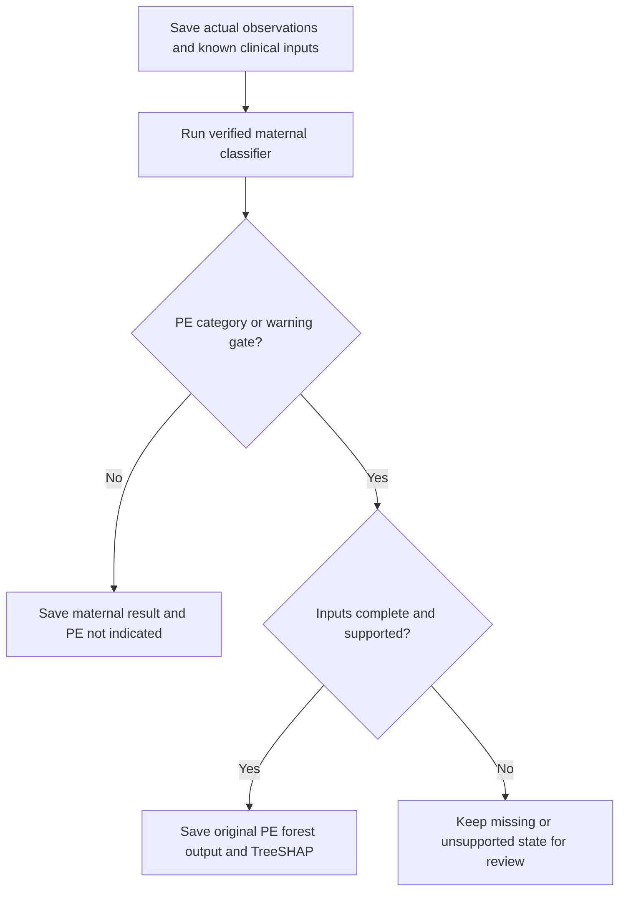
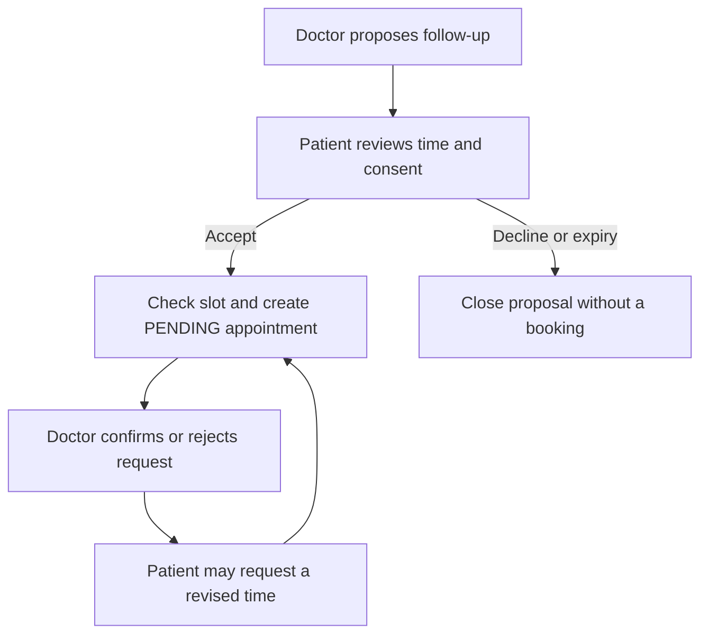

# BloomCare requirements and design traceability

Current release: 1.2.0, 21 October 2026. The mapping below was carried forward from the earlier review of the supplied SRS/SDD; the original PDFs were not re-reviewed in this pass. Historical checkpoint labels identify when work was delivered. The current implementation includes all subsequent addenda.

# SRS delivery addendum - BloomCare v0.9.0

Date: 16 October 2026. This addendum maps the delivered source to the user's
`BloomCare_SRS(1).pdf`. The original supplied PDF is unchanged. Requirement IDs
below follow the SRS; the older SDD numbering diverges after FR-05 and must not be
used to identify these requirements. This is a delivery traceability record, not
a claim of stakeholder sign-off or medical certification.

## Functional requirements

| SRS ID | Requirement | v0.9.0 implementation and boundary |
| --- | --- | --- |
| FR-01 | User authentication | Website patient/doctor registration, role-aware sign-in, hashed passwords, signed session cookie and logout. Admin is managed separately. |
| FR-02 | Role-based access | Backend patient/approved-doctor/admin checks; own-record access and selected, time-limited care grants. Admin account/activity oversight is role scoped. |
| FR-03 | Maternal assessment | One input form with core observations and optional known antenatal measurements. Defaults mg/dL/F; optional mmol/L/C conversions; physical record bounds and separate inference bounds. |
| FR-04 | Pregnancy risk prediction | Actual registered independently trained maternal Random Forest and stored model version/scores. No rule-based replacement; existing trained artifact is retained by this update. |
| FR-05 | Staged PE screening | MEDIUM/HIGH or SBP >=140, DBP >=90, history of hypertension, or recorded proteinuria opens PE. Supported complete inputs auto-run the pinned original forest. Missing inputs request completion; unsupported values are saved and routed to review. |
| FR-06 | Explainable AI output | Per-feature contributions, explained category, base and record model scores for both supported model stages. |
| FR-07 | AI care plan generation | Explicitly consented Groq generation using the selected assessment, measurements and actual PE state. Saved guide with provider/language/context provenance; no generated fallback on failure. Live key/provider access required. |
| FR-08 | Assessment storage | Immutable maternal observations/results; separately stored PE, clinical input snapshot, saved care-plan versions and review history in PostgreSQL. Record request UUID prevents duplicate retry saves. |
| FR-09 | Patient history | Own assessment/history views; accepted approved doctors see only selected records during active grants. Completed PE is consistent in history, timeline, passport and allowed family summary. |
| FR-10 | Appointment scheduling | Registered patients request approved doctors; consent and selected records; future-slot and collision checks. Includes patient rescheduling and clinician follow-up proposals. |
| FR-11 | Appointment status | Doctor acceptance/rejection/completion with state checks. Rescheduling returns to PENDING, ends old access/calls and removes old report shares. |
| FR-12 | Doctor notes | Approved, authorized clinician notes; optional assessment linkage; public/private visibility; author-owned append-only amendments retain originals. Public corrections remain patient visible. |
| FR-13 | Review status | Per-assessment PENDING/REVIEWED/URGENT_FOLLOW_UP, reason and optional follow-up time, optimistic version checks and immutable change events. |
| FR-14 | Urgent follow-up | Doctor-authored urgent review instructions, patient notification, admin oversight and optional follow-up appointment proposal. Patient acceptance does not silently confirm the appointment. |
| FR-15 | PDF reports | Local jsPDF, paginated observations and known clinical values, maternal/PE results, SHAP, saved guide/freshness, review and patient-visible notes. Embedded Latin/Urdu fonts; full report generation checked. |
| FR-16 | WhatsApp alerts | Twilio server integration with approved-recipient list, consent, request-id deduplication, rate limit and provider status retrieval. Requires configured sender/account/template/session; automated real delivery is not claimed from mocked tests. Device PDF sharing is a separate implemented workflow. |
| FR-17 | Analytics | Stored category counts and native SVG charts, role-scoped doctor cases/review progress, admin totals and actual patient measurement trends. Saved-review groups in admin analytics describe stored review rows. |
| FR-18 | Search/filter | Admin name/email/role/active filters; authorized doctor patient/assessment search; own history risk/review/date filters; pagination. Local date filters become UTC boundaries; invalid/naive/reversed intervals rejected. |
| FR-19 | Frontend protection | Authenticated role routes plus session-expiry handling; backend independently enforces the same authority. |
| FR-20 | Video consultation | Appointment-linked protected WebRTC signaling and doctor-start/patient-join UI; access window and end-call checks. Target-device media, HTTPS and cross-network TURN checks remain environmental acceptance work. |
| FR-21 | Medical report upload | Validated PDF/image uploads, own downloads and selected doctor shares; revocation and care-episode access. |
| FR-22 | AI maternal assistant | Separate consented Groq query feature, optional selected own-record context, English/Urdu answers, retry/history controls. Does not create screening predictions. |
| FR-23 | Pregnancy tracker | Saved due date or latest recorded gestational week plus elapsed days; trimester, planning milestones, guidance and recorded trends. No invented dates when source data is absent. |
| FR-24 | Medication reminders | Patient medication entries and one-time/12-hour/24-hour reminder choices; background deduplicated in-app notifications while the backend is running. No OS push or external medication delivery. |
| FR-25 | Symptom monitoring | Patient symptom entries, severity and historical timeline within own/authorized scope. |
| FR-26 | Digital health passport | Own consolidated summary, observations, medications, symptoms and recent full assessments/care plans. Authorized sharing remains explicit. |
| FR-27 | SHAP explainability | Actual TreeSHAP for maternal model and original PE forest/node weights; additive/model-parity verification and zero unused-feature contributions. |
| FR-28 | Notifications | Persisted in-app appointment/message/review/urgent/care-plan/follow-up/reminder notices, read state and assessment links. UI uses periodic polling; this is near-real-time delivery, not WebSocket or background OS push. |
| FR-29 | Multilingual support | English/Urdu selector and RTL; new clinical screens/consents/statuses/tracker labels translated. Urdu generated text and patient-visible notes retain Arabic shaping in PDF. User-entered content is not silently translated; PDF section labels are English. |
| FR-30 | Family portal | Account-bound invitations, explicit selected category consent, expiry and revocation. Read-only limited summaries; no private clinician notes or raw assessment observations in family assessment summaries. |
| FR-31 | Evaluation dashboard | Admin-protected registered maternal model metrics/provenance and verification information. Reported model scores/metrics remain visible as evidence, not clinical accuracy guarantees. |
| FR-32 | Deployment support | PostgreSQL config, migrations, environment management, startup/preflight, backups/guarded restore, cumulative Windows update and optional deployment templates. Actual hosted deployment/HTTPS/recovery/load validation remains unexecuted. |

## Business-rule clarifications

- SRS BR-07 specifies mg/dL only. v0.9.0 uses mg/dL by default and adds an explicit
  mmol/L choice, converting to the unchanged canonical backend/model unit. This
  is an intentional usability extension; it must be recorded as a variation.
- Model coverage hints are faint placeholders, not normal clinical ranges. The
  application permits real records outside model coverage within its record
  bounds and refuses unsupported inference. It does not clamp measurements.
- The PE warning gate and the original model's usable feature domain are
  different constraints. In particular, systolic >=140 triggers review/screening,
  while the legacy model supports only 90-130. It cannot generate a valid result
  for that warning value without a different validated model.
- SHAP weights were exported from the pinned original model. Web requests load
  checked JSON arrays; they do not deserialize the old pickle.
- Groq care guides and questions require distinct user actions/consent. Neither
  replaces a doctor's review, prescriptions or the deterministic model pipeline.
- External WhatsApp messages require explicit action, permitted recipients and
  provider configuration. QUEUED/SENT do not mean DELIVERED; UNCERTAIN does not
  cause an automatic second send. Opening a native share sheet is not proof of
  message delivery.

## Nonfunctional acceptance and remaining external work

| Area | Evidence or remaining acceptance work |
| --- | --- |
| Automated correctness | Backend 187 passed, 1 PostgreSQL-only test skipped in this Linux SQLite run. Frontend 95 passed. Populated migration and real-model/SHAP tests included. See release verification. |
| PostgreSQL destination | Windows updater runs the full migration/API suite in a disposable local PostgreSQL database before the application migration. This v0.9.0 suite has not yet been run on the user's Windows host. |
| Prediction quality | Current maternal held-out accuracy 71.11%, MEDIUM recall 33.33%. This does not meet an 85% target. PE's legacy 90.24% result has test/training overlap and cannot establish independent performance. |
| Performance and concurrency | Frontend production build verified. The SRS response-time/100-user targets were not load tested against a deployed PostgreSQL/provider stack. No invented benchmark is supplied. |
| Security/operations | Role/ownership/consent/revocation and secret-preservation tests pass. Production TLS/cookie settings, operational key management, provider configuration and recovery still require destination review. |
| Availability | Local startup and bounded failure/retry paths exist. No uptime, hosted availability or disaster-recovery guarantee was tested. |
| Browser/device acceptance | Component tests cover navigation, permission/error/consent paths and workflows. Actual camera/microphone, native sharing and mobile layout must be checked on target devices; live browser visual QA was unavailable here. |
| Clinical acceptance | Source-unit gaps, PE coverage and held-out evidence require qualified review and better independent data. Software integration does not remove these limitations. |

All requested functional module source is retained in the combined release.
Provider activation and the outstanding acceptance conditions above are explicit
handover items, rather than hidden claims of completed production validation.

# SDD delivery addendum - BloomCare v0.9.0

Date: 16 October 2026. This describes the actual delivered architecture and
supersedes conflicting implementation details in the supplied older design PDF.
The original PDF remains unchanged. Requirement references use the original SRS
FR-01 through FR-32; the older SDD's numbering diverges after FR-05.

## Implemented architecture

The browser runs a React/Vite application with role-based routes, English/Urdu
layout, grouped patient tools and a top-level video entry. Requests use the
same-origin `/api` path and an authenticated HTTP-only cookie. FastAPI performs
authority and validation independently of the UI. SQLAlchemy/Alembic target
PostgreSQL; isolated automated tests also use SQLite. UUID string identifiers and
normalized tables replace the older two-entity/integer-ID sketches.

| Layer | Current modules and responsibilities |
| --- | --- |
| UI input/history | `health-form.jsx`, `assessments.jsx`, `pe-screening.jsx`, `search-ui.jsx`; actual-value entry, conversion, staged results, filters. |
| UI clinical workflows | `clinical-ui.jsx`; saved care guide, reviews/history, proposal/acceptance, reschedule, amendment, PDF/share and alert actions. |
| UI monitoring | `analytics-ui.jsx`; native SVG category/trend charts, authorized doctor workspace, pregnancy milestones, admin oversight. |
| PDF | `pdf-export.js`, pinned local jsPDF and embedded DejaVu/Noto Naskh fonts. No CDN runtime requirement. |
| Core APIs | Auth/roles, assessment, appointments, patient care, reports/messages/notifications, family, assistant, video and admin routers. |
| Delivery APIs | `delivery_api.py` delegates to care-plan, clinical-review, follow-up and WhatsApp services. |
| Inference | Verified registered maternal model plus pinned legacy PE JSON forest; original fitted node weights feed actual TreeSHAP. |
| Persistence | 29 SQLAlchemy application tables plus Alembic revision tracking; database constraints, row locks/CAS checks and immutable history records. |
| External services | Explicitly consented Groq text generation, opt-in Twilio alert delivery, and peer-to-peer WebRTC media using configured ICE. |

Native SVG charts are a deliberate implementation variation from the old Recharts
proposal. jsPDF and Twilio are now actual integrations, rather than descriptions
of browser printing/manual report sharing alone. The application loads no old PE
pickle during an API request. SQLite remains an isolated-test option, not the
Windows application database in this delivery.

## Assessment and care-plan flow

Record request UUIDs are unique per patient. Repeating the same body reuses the
record; changing a previously used request ID returns 409. Model failure after a
record save returns the saved record ID. Missing clinical values are not guessed.
Maternal results remain immutable; effective PE state is derived consistently
from saved input/child results for history, passport and family summaries.

After a separate consent action, the care-plan service hashes the exact saved
context plus language. A READY version may be reused; provider generation has an
in-progress lease, rate limit and failure cooldown. Name/email are excluded from
the provider context. Provider failure stores the failed attempt without a fake
answer. A plan whose context no longer matches is returned as stale so the UI/PDF
can request an updated guide.

## Clinical authority and changes

Doctor access requires an active approved doctor, an accepted unexpired care
episode, an active patient and that assessment's selected record. This check
applies before review, explanation, report-data and note operations. Patient
revocation removes subsequent access and case-analytics inclusion.

Clinical review has a monotonically increasing version. The UI submits the
version it saw; a conflicting update returns 409. Each accepted change also saves
an immutable review-event snapshot with actor and appointment and creates a
patient notification. A missing review is displayed as PENDING.

An author can append a note amendment under an authorized appointment. The new
note references its predecessor; original text remains stored. A predecessor has
at most one direct successor. A public note cannot acquire a hidden correction.
Patient PDF data contains only patient-visible notes linked to that assessment.

Proposals have a doctor request UUID and expire after at most 72 hours or their
scheduled start. Acceptance is patient scoped and atomically links the requested
appointment. Rescheduling uses the appointment's last-update timestamp, approved
doctor and slot checks. It resets PENDING, ends record access and active calls,
removes report-share rows and notifies the doctor. The new appointment still needs
doctor confirmation; reports must be explicitly shared again.

## Persistence model

There are 29 application tables. Clinical content is stored in its specific
entity, rather than embedded appointment/note arrays on a user row.

| Group | Tables |
| --- | --- |
| Identity and audit (5) | users, patient_profiles, doctor_profiles, account_events, access_audit |
| Observations and models (5) | health_records, model_versions, assessments, pe_screenings, assessment_care_plans |
| Appointment lifecycle (4) | appointments, appointment_records, appointment_events, follow_up_proposals |
| Clinician documentation (3) | doctor_notes, clinical_reviews, clinical_review_events |
| Patient daily records (2) | symptom_entries, medication_entries |
| Files and grants (2) | medical_reports, report_shares |
| Communication (2) | care_messages, notifications |
| Family and reminders (2) | family_grants, medication_reminders |
| Assistant (1) | assistant_turns |
| Video (2) | consultations, consultation_signals |
| External alert tracking (1) | whatsapp_alerts |

Migration `0010_delivery_workflows` adds five workflow tables, clinical snapshots,
record request IDs, PE explanations, note amendment/assessment links and
assessment-linked notifications. It preserves old data and updates the PE parent
constraint to permit warning-triggered LOW maternal assessments. The migration is
forward-only; rollback uses a verified database backup with matching source.

## Principal added API contracts

All paths below have the `/api` prefix. Existing auth, care and communication
routes remain present. UUID ownership is checked; knowing an identifier does not
grant access.

| Method/path | Authority and purpose |
| --- | --- |
| POST /patients/me/complete-assessment | Patient; idempotent save plus actual staged inference. |
| POST /patients/me/assessments/{id}/care-plan | Owner; explicit Groq consent/language, persisted context version. |
| POST /patients/me/assessments/{id}/pe/explanation | Owner; add real pinned-model explanation only if saved scores match. |
| PUT /doctors/me/appointments/{appt}/assessments/{id}/review | Authorized approved doctor; expected version and review instructions. |
| GET .../assessments/{id}/reviews | Owner or authorized appointment doctor; immutable event history. |
| POST /doctors/me/appointments/{appt}/notes/{id}/amend | Authorized original author; append correction without deleting original. |
| POST /doctors/me/appointments/{appt}/follow-ups | Authorized doctor; proposal, assessment and request UUID. |
| GET /patients/me/follow-ups | Patient's own proposals. |
| POST /patients/me/follow-ups/{id}/accept or /decline | Patient; acceptance requires sharing consent and slot checks. |
| PATCH /patients/me/appointments/{id}/reschedule | Patient; expected last-update timestamp and sharing confirmation. |
| GET /doctors/me/cases and /doctors/me/analytics | Approved doctor; active selected records only. |
| GET /admin/clinical-reviews | Admin; persisted review oversight/search. |
| GET .../assessments/{id}/report-data | Owner or authorized appointment doctor; safe report projection. |
| GET /patients/me/whatsapp/status | Patient; capability flags, no secrets. |
| POST /patients/me/assessments/{id}/alerts | Owner; consent, approved E.164 contact, request UUID and rate limit. |
| GET /patients/me/alerts/{id} | Owner; authenticated provider status retrieval, no resend. |
| GET /patients/me/pregnancy-tracker | Patient; saved-date-derived progress and planning milestones. |

## External effects, failures and information boundaries

Twilio sends use a fixed HTTPS endpoint, authentication kept on the server and
bounded timeouts. A durable SUBMITTING reservation is committed before the
outbound call. Retrying its request UUID returns the existing result. Provider
errors/timeouts are represented as FAILED or UNCERTAIN, not success; no automatic
second send follows an unknown outcome. Provider message IDs are validated and
cannot change during refresh. QUEUED/SENT and DELIVERED/READ remain distinct.

Only two dynamic category/stage values are sent through an optional approved
template. The full PDF is prepared through a separately authorized read and
shared only after the patient chooses the external app/recipient. Native sharing
or downloading a PDF does not prove it was delivered through WhatsApp.

Core saved timestamps are serialized in UTC. Frontend date-only filters represent
the user's local day and become timezone-aware UTC interval bounds. Database
transactions protect mutations; PostgreSQL-only lock behaviour is tested by the
Windows disposable-database runner rather than claimed from SQLite.

Secrets, original private model artifacts, patient uploads and database backups
are excluded from the distribution archive. The offline PE explanation exporter
is a maintainer tool that validates the original pickle digest before loading it;
the hosted application reads checked JSON only.

## Verification boundary

See [VERIFICATION-0.9.0.md (archived)](history.zip) for actual results. Provider API
effects are mocked in automated tests; live account approval/delivery, native
sharing, device media/TURN, hosted TLS, disaster recovery and deployed load remain
destination checks. Original model quality, coverage and unit limitations remain
unchanged by the new design.

# SRS/SDD release addendum - v1.0.0

16 October 2026. The original supplied SRS/SDD PDFs remain unchanged. The v0.9.0
addenda retain the full FR-01 through FR-32 mapping; this file records the new
implementation and acceptance evidence. Requirement IDs follow the SRS, avoiding
the older SDD's numbering mismatch after FR-05.

| Requirement area | v1.0.0 delta |
| --- | --- |
| FR-01/02/19 identity/access | Three role-specific workspaces with independent protected summary endpoints. Unapproved doctors receive no patient data. Existing ownership/grant policies remain authoritative. |
| FR-03/05 assessment and PE | Exact unsupported field/value/bounds in the assessment and exported report. Actual records remain immutable; unsupported inference remains unavailable. |
| FR-04/06/27 model output/explanation | Existing registered model and actual explanations retained; weaker retraining candidates do not silently replace them. Candidate model exports are inactive, non-executable JSON evidence. |
| FR-09/10/11/13/14 clinical workflows | Overview links prioritize selected records, next appointment, review queue and clinician follow-up. Accepted appointments only open clinical review when access is currently available. |
| FR-15/16 report/sharing | PDF includes coverage details. Share-sheet handoff and external delivery are explicitly different; automatic alert setup has a usable manual-PDF alternative. |
| FR-17 analytics | Real SQL totals rather than list lengths; correct review counts include assessments without a first review. Semantic risk/status colours are stable across database result order. |
| FR-18 search/filter | Pending/approved doctor filtering and usable links into prefiltered account management. |
| FR-29 language/accessibility | New patient/doctor/admin strings in Urdu, keyboard-operated administration tabs, focus restoration and reduced-motion styling. |
| FR-31 evaluation | Protected, lazy-loaded training evidence shows executed configurations, old comparison limits, failed promotion checks and actual legacy PE data-quality findings. |
| FR-32 operations | Same schema head 0010; updated cumulative Windows checks, training commands, local synthetic benchmark, URL-log suppression and preserved private runtime state. |

## Current architecture

React uses a shared shell with role colour tokens and dedicated workspaces. The
main route tree uses Suspense and lazy feature imports with an error boundary.
Workspace requests validate response shape and expose explicit retry states.
Administration opens only the selected management tab and model evidence on demand.

`workspace_api.py` returns bounded, authorized dashboard projections with actual
database totals. Doctor analytics are restricted to active selected-record grants;
patient projections use only the signed-in account. `training_api.py` projects
fixed release evidence for administrators and does not execute model training in
an HTTP request or expose candidate tree payloads.

The persistence model remains the 29 normalized application tables from v0.9.0.
No new table or reset is needed. New PE coverage metadata is a derived response
field, not a replacement for saved observations or historical model output.

`ml/train_comparison.py` and `ml/retrain_legacy_pe.py` provide reproducible offline
training, grouped evaluation, inactive evidence exports and non-regression checks.
Existing model trust and application activation are retained. Model quality cannot
be raised by relabelling records, shifting the comparison partition or claiming an
independent evaluation that was not run.

## Quality acceptance

Executed results are in VERIFICATION-1.0.0.md and PERFORMANCE-1.0.0.json. The
functional/code changes and internal tests do not by themselves satisfy clinical
validation, an 85% accuracy target, independent PE outcome validity, hosted uptime,
production 100-user concurrency, or target-device media acceptance. Those material
limits remain explicit in the delivery.

Existing modules are retained. This release improves their presentation,
information flow, access handling and review evidence; its new interface does not
change the meaning of the original clinical source data.

# SRS / design addendum — v1.0.1

17 October 2026. This update implements the reported privacy, visual hierarchy, correction and service-status gaps. Earlier requirement mapping and actual model-evaluation reports remain in the package.

| Area | Acceptance behavior |
| --- | --- |
| Privacy and access | Current role controls the privacy content and relevant navigation. API roles and ownership remain authoritative. No secrets are exposed in diagnostic responses. |
| Record correctness | Owner supplies a reason and confirms deletion of an erroneous assessment. An immutable audit copy remains; active clinical queries and analytics exclude the removed result. Existing clinician notes/reviews stay labelled and scoped. |
| PE workflow | Exact source-model limits, affected readings and unavailable/no-result reasons are distinct from missing measurements. The clinician workflow remains available without a PE prediction. |
| Interface | Shared navy structure, one accent per role, semantic risk colours, responsive privacy cards, on-demand deletion log and service instructions. |
| Video and availability | Parsed direct/STUN/TURN/invalid configuration modes replace the old string comparison. Local device checks release tracks on stop, cancellation and unmount. Live connectivity remains separately verified. |
| External sharing | Manual PDF sharing and automatic Twilio alerts have separate instructions. Sandbox joining, active window and registered-sender template conditions are explained. |
| Maintainability | The API and Windows wizard reuse one pure ICE validator. Additive migration 0011 preserves the previous schema’s rows. Current versioned delivery checks identify the new columns and UI assets. |

The 29-table architecture is retained. Two nullable assessment lifecycle columns record removal time and reason. Original measurements, trained artifacts, model trust, accounts and historical clinician decisions are preserved. Removal does not erase already exported copies or existing backups.

Verification covers authorization, ownership, projection filters, retries, invalid configuration and device cleanup. Browser visual QA, Windows/PostgreSQL execution and live services must be checked on the destination environment; clinical validation remains outstanding.

# Requirements and design addendum — v1.0.2

18 October 2026. Existing requirement mapping and model-evaluation evidence remain available. This change closes the reported correction/discoverability gap and clarifies patient information.

| Area | Behavior |
| --- | --- |
| Patient comprehension | Model test statistics and dataset-audit terminology live in admin evidence; understandable model limitations stay on the patient result page. |
| Record correction | An owner can confirm removal of a mistaken health record and all linked assessments from active care. Assessment-only removal remains distinct. |
| Authorization | Server-side ownership and role checks protect deletion. Active appointment consent still governs clinical access. Removed records cannot be newly shared. |
| Consistency | Source and dependent results are withdrawn in one transaction. Histories, analytics, family access and future provider contexts use active records only. |
| Accountability | Original observations and clinical decisions remain auditable. Note amendments preserve the original chain and cannot restore deleted-result access. |
| Discoverability | Delete actions appear on Health history and saved-measurement detail; record entry links to history. |
| Installation clarity | Footer version and on-demand interface/server comparison reveal incomplete updates. Additive migration0012 and required-column checks identify the current release. |

No trained model, evaluation score, source split, model coverage or clinical-validation status changes. Previous training reports remain historical evidence; this is a software workflow update.

## v1.0.3 clarification

Pregnancy duration remains a saved observation (0–45 weeks), not a maternal-model feature. Triggered PE screening remains limited to observed 14–40-week coverage. Explicit entry/result explanations and real-model regression tests cover 12 weeks and the inclusive 14/40-week boundaries. No category is invented outside coverage. Historical guides, obsolete update commands and inactive fitted comparison trees are consolidated in history.zip. Live schema migrations and all feature modules remain.

## v1.1.0 account and deployment completion

FR-01 account lifecycle now includes emailed verification and self-service reset, single-use expiring hashed actions, generic recovery responses, database-persisted authentication/recovery limits and password-reset session revocation. Doctor approval remains independent of email verification. The additive migration preserves users and clinical rows. Public Compose enforces verified email and secure same-origin HTTPS configuration, while local enforcement defaults off until SMTP is configured. A safe isolated restore-test operation, public preflight and final checklist supplement FR-30/31/32 engineering delivery; live destination/clinical evidence is still not claimed.

## v1.2.0 interface and free-hosting addendum

The delivery includes a coordinated colorful UI across all actors, original maternal-specific logo/favicon, compact menus/history, and the existing top video action. Provider-subdomain hosting is supported through a same-origin Render Docker/Blueprint with external Neon PostgreSQL. Brevo HTTPS account email addresses Render Free SMTP restrictions; the existing Forgot password and verification flow is retained. First cloud admin setup requires mailbox recovery and cannot promote a patient. Free-hosting limitations and exact account/key paste locations are documented in FREE-DEPLOYMENT.md. No live deployment, real provider delivery or new clinical validation is asserted by this addendum.
